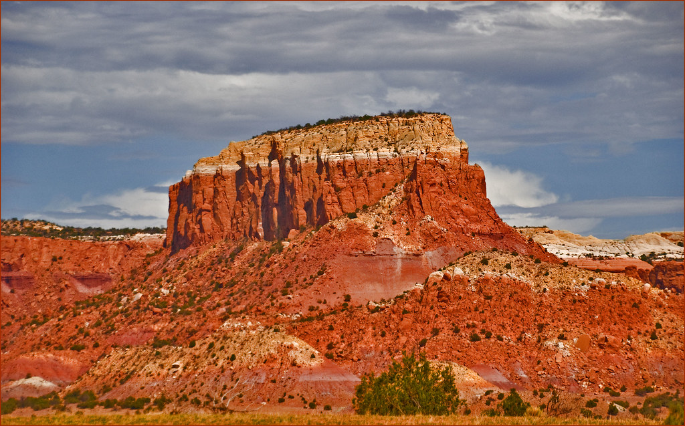

Der **Coelophysis** ist einer der bekanntesten Dinosaurier aus dem Trias. Um genau zu sein lebte er vor 225-204 Millionen Jahren und war somit Teil zweier Perioden, der Obertrias und der Unterjura. Der **Coelophysis** war ein relativ kleiner Dinosaurier. Mit seinen bis zu 3m und seinen 20-30kg war er in etwa so groß wie ein kleines Auto und wog nur so viel wie ein 8-jähriges Kind. Der **Coelophysis** hatte einen sehr biegsamen,
s-förmigen Hals, mit dem er schnell nach, am Boden liegenden Reptilien oder vor ihm in der Luft fliegenden Insekten schnappen konnte. Wenn er auf der Jagt nach kleinen Insekten und Reptilien oder auf der Flucht vor größeren Räubern war, konnte er bis zu 48km/h erreichen. Sein langer, dünner Schwanz half ihm dabei das Gleichgewicht zu wahren.

Die hohlen Knochen, schlanken, langen Gliedmaßen und der längliche, schmale Schädel sind charakteristische Merkmale für Theropoden. In vielen Skeletten fand man kleinere Knochen im Inneren des Körpers. Erste Vermutungen waren, dass **Coelophysis** Kannibalen waren, jedoch stellte sich später heraus, dass es sich um die Knochen kleiner Reptilien handelte.
In seinem ganzen Körperbau war **Coelophysis** für seine Zeit schon sehr fortgeschritten.
Paläontologen fanden aber auch unterschiedliche Skelette, schlankere und robustere. Dies deutet darauf hin, dass es Abweichungen im Körperbau bei weiblichen und männlichen Exemplaren gab.

Das erste **Coelophysis-**Skelett wurde 1881 von David Baldwin in New Mexico, USA entdeckt. Acht Jahre später, 1889, fand Edward Drinker Cope nochmals Skelette auf der Ghost Ranch, New Mexico. Später wurden noch weitere **Coelophysis** Skelette am gleichen Fundort entdeckt, bis es schließlich über 1000 Skelette waren. Das macht den **Coelophysis** zum offiziellen Dinosaurier des Bundesstaats New Mexicos.
So viele Skelette einer Art an einem Ort, lässt vermuten, dass **Coelophysis** in Herden lebten. Diese Theorie ist nicht vollständig bewiesen, aber naheliegend. Vermutlich entstand das Massengrab durch eine ausgetrocknete Wasserstelle, was viele Dinosaurier, darunter auch **Coelophyis**, verdursten ließ. Später wurden sie wahrscheinlich durch eine Sturzflut in das Gebiet der Ghost Ranch geschwemmt.

1998 wurde ein Schädel des **Coelophysis,** aus dem Carnegie Museum of Natural History in Pittsburgh, mit dem Raumschiff Endeavour ins Weltall genommen. Zusammen mit dem [Maiasaura](/dinos/maiasaura/) ist er der einzige Dinosaurier, der im All war.
